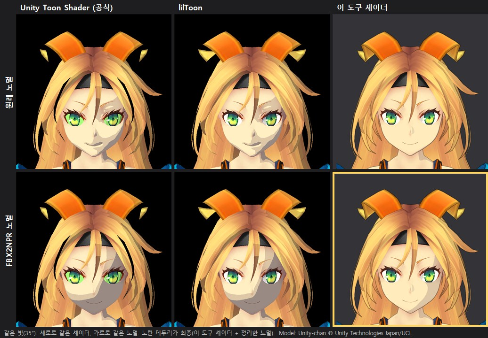
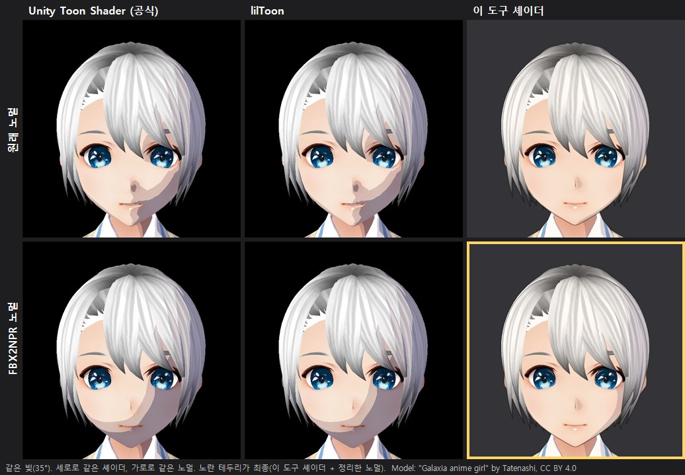
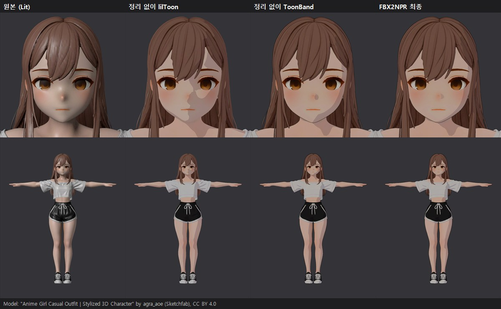

# FBX2NPR

툰을 고려하지 않고 만든 3D 캐릭터(FBX)를 Unity 안에서 메뉴 한 번으로 툰 캐릭터(프리팹)로 바꾸는 도구입니다. 실사풍 캐릭터와, 얼굴 노멀이 정돈되지 않은 애니풍 캐릭터(사람이 만든 것, AI로 만든 것 모두)를 대상으로 합니다.
핵심은 툰 셰이더에서 얼굴 그림자가 얼룩지는 문제를 3D 툴 왕복 없이 얼굴 노멀 정리로 줄이는 것이고, 정리한 노멀은 lilToon·UTS 같은 다른 툰 셰이더에서도 효과가 있습니다. 외곽선/명암선, 부위 인식 모델 기반 피부 다시 그리기, 회화풍 모드를 함께 만들었고, 좋아진 정도와 안 되는 범위, 성능 비용은 숫자로 측정했습니다.

Unity 6 URP / C# / HLSL / Unity Inference Engine(ONNX). 결과 표의 캐릭터 8명: 믹사모 캐릭터 3, 유니티짱 1, 애니풍 4 (Sketchfab CC BY)

## 왜 필요한가

툰 셰이더는 빛을 받는 정도를 0/1(또는 몇 단계)로 끊어 칠합니다. 그래서 얼굴 노멀의 작은 요철이 부드럽게 묻히지 않고 그림자 경계의 얼룩으로 그대로 드러납니다.

툰 셰이더에서 얼굴 그림자가 지저분하게 나오는 문제는 크지는 않지만 꾸준히 있는 문제입니다.

* lilToon README의 "자주 있는 문제"에 "얼굴 그림자가 지저분하다(The shadows on face are dirty)"가 있고, 해결책으로 마스크 텍스처로 가리라고 안내합니다.
* 같은 문제를 푸는 유료 도구가 팔리고 있습니다.
  * lilEasyFace (BOOTH, ¥500): "노멀을 손으로 편집하지 않아도 된다"고 소개합니다.
  * Easy Custom Normals (Superhive, $10~20, 200건 넘게 판매): "토폴로지가 불완전해도 깨끗한 노멀"을 내세웁니다.
* 무료 도구도 있습니다.
  * Blender 애드온 Abnormal(BNPR)의 "Normal Spherizing"이 있습니다. 이 프로젝트의 방사형 정리와 같은 방식입니다.
  * BOOTH에는 "法線転写(노멀 전사)" 도구가 18개 있습니다.
* 보통은 Blender에서 공 모양 노멀을 옮겨 오거나(노멀 전사), 그림자 텍스처를 따로 그려 굽습니다.

이 도구는 그 작업을 Blender를 오가지 않고 Unity로 가져오는 단계에서 하고, 정리한 노멀이 어떤 셰이더에서도 쓰이게 하는 것을 목표로 했습니다.

아티스트의 손 작업을 대신하는 도구가 아니라 시작점을 자동으로 만드는 도구입니다. 기본 정리는 Blender 없이 끝나고, 더 다듬고 싶은 곳만 얼굴 영역을 Blender로 보내 손본 뒤 다시 불러올 수 있습니다(다시 변환해도 유지).

출처

* lilToon README "Common Problems": https://github.com/CuteWaterBeary/shaders.lilxyzw.liltoon (1.3.8 README 사본. 현재 공식 README는 문서 사이트로 연결됨)
* lilEasyFace: https://booth.pm/ja/items/8566350
* Easy Custom Normals: https://superhivemarket.com/products/stylized-normals
* Abnormal: https://github.com/bnpr/Abnormal
* 참고: GDC 2015 "GuiltyGearXrd's Art Style" https://gdcvault.com/play/1022031 (노멀 편집 세부 내용은 2차 자료로만 확인함)

## 사용한 이론

아래 이론들을 Unity 안에서 하나로 묶고, 결과를 숫자를 기반으로 측정하였습니다.

**얼굴 그림자 정리**

* **X-Toon의 노멀 섞기** (Barla 외, NPAR 2006) — 원래 노멀과 단순한 모양의 노멀을 0\~1 사이 값 하나로 섞어, 형태를 얼마나 단순하게 볼지 정하는 방법입니다.  
→ 얼굴 노멀을 "머리 중심에서 바깥으로 뻗는 방향(공 모양)"과 섞습니다. 1에 가까울수록 공처럼 매끈해져 얼룩이 줄어듭니다. `RadialNormals`
* **구면 선형 보간 (slerp)** — 두 방향 사이를 구의 표면을 따라 고르게 잇는 보간입니다. 단순히 섞고 길이만 맞추는 Lerp는 두 방향이 많이 다를수록 중간값이 틀어집니다.  
→ 처음에는 Lerp로 해서 블렌더 결과와 최대 34° 어긋났고, slerp로 바꿔 평균 0.003°까지 맞췄습니다 (Ch07).

**외곽선**

* **소벨(Sobel) 필터** — 주변 3×3 픽셀과 값이 크게 다른 곳을 경계로 찾는 기본 영상처리 필터입니다.  
→ 화면의 깊이(카메라까지 거리) 이미지와 노멀 이미지에 걸어, 값이 갑자기 바뀌는 곳에 선을 긋습니다. 깊이 차이는 그 점의 깊이로 나눠 가까이서든 멀리서든 같은 기준으로 선을 찾습니다. `SobelOutline.shader`

**툰 스타일 명암**

* **램버트 조명 + 셀 셰이딩** — 면이 빛을 정면으로 받을수록 밝다는 기본 조명 모델입니다(밝기 = 노멀과 빛 방향의 내적, N·L). 셀 셰이딩은 이 밝기를 2\~3단계로 뚝 끊어 칠하는 방식입니다.  
→ 얼굴은 N·L의 좌우 성분만 써서 명암 경계가 이마부터 턱까지 한 줄 곡선이 되게 했습니다. 턱 쪽으로 휘는 모양은 일러스트를 보고 직접 설계했습니다. `ToonBand.shader`

**회화 스타일 모드**

* **이방성 쿠와하라 필터** (Kyprianidis 외, 2009) — 픽셀 주변을 여러 조각으로 나눠 색이 가장 고른 조각의 평균으로 칠합니다. 경계는 남고 안쪽은 붓으로 민 듯한 색면이 됩니다. 조각을 그림의 결 방향으로 기울인 타원으로 잡는 것이 "이방성"입니다.  
→ 텍스처를 유화 색면처럼 바꾸는 첫 단계입니다. `PainterlyCore`
* **선적분 합성곱 (LIC)** (Cabral & Leedom, 1993) — 노이즈를 정해진 흐름 방향으로 길게 끌어 줄무늬를 만드는 기법입니다. 원래는 바람/물의 흐름을 그림으로 보여 줄 때 씁니다.  
→ 쿠와하라만으로는 그냥 흐려 보여서, 결 방향으로 붓털 줄무늬를 더했습니다. `PainterlyCore`

**얼굴 다시 그리기**

* **얼굴 파싱 (BiSeNet)** — 얼굴 이미지의 픽셀마다 피부/눈썹/눈/코/입술 같은 부위 이름을 붙여 주는 딥러닝 모델입니다.  
→ 공개된 학습 완료 모델(CelebAMask-HQ로 학습한 ONNX)을 Unity 안에서 실행합니다. 렌더한 얼굴에 돌린 결과를 텍스처 좌표(UV)로 되돌려, 텍스처의 어디가 눈썹이고 입술인지 알아냅니다. `FaceParser`
* **이중 문턱 + 연결 성분** (Canny 엣지 검출과 같은 구조) — "확실한 것"을 씨앗으로 두고, 거기에 붙어 있는 "애매한 것"을 이어 붙입니다. 따로 떨어진 애매한 것은 버립니다.  
→ 피부에서 지울 것(모공/구워진 그늘)과 남길 것(눈썹/아이라인/입술)을 가릅니다. `SkinFlatCore`

**웹캠 데모**

* **최소제곱법** — 데이터 여러 개에 가장 잘 맞는 식을 찾는 방법입니다. 식으로 계산한 값과 실제 값의 차이(오차)를 제곱해 모두 더하고, 그 합이 가장 작아지는 계수를 고릅니다.  
→ 웹캠 영상에서 얼굴 피부 지점 수백 곳(얼굴 메시 점 중 눈/눈썹/입술/테두리를 뺀 곳)의 밝기를 읽고, 그 지점의 표면 방향(노멀)과 짝지어 데이터로 씁니다. 이 데이터에 "밝기 ≈ 상수 + c·노멀"을 맞춰 c를 구하면, c의 방향이 방의 빛 방향이 됩니다. 초당 15번 추정해 명암선이 실제 빛을 따라오도록 하였습니다. `ARFaceDemo`

**결과 측정**

* **연결 성분 세기** — 같은 색으로 이어진 덩어리가 몇 개인지 셉니다.  
→ 3단으로 칠한 회색 렌더에서 얼굴의 덩어리 수를 "얼룩 수"로 씁니다. 노멀 정리 전후 41\~69% 줄었습니다 (4명 정면, 노멀 정리 단계 실험).

**이론이 아닌 부분** — 코 그림자 모양(초승달/물방울)과 명암 선이 눈 부위를 피해 돌아가도록 하는 방식은 서브컬쳐 이미지를 기반으로 설계되었습니다.

## 하는 일

1. 얼굴 노멀 정리 — 머리 본 가중치로 얼굴 정점을 고르고, 얼굴 중심 기준 방사형으로 정리합니다. 원래 노멀은 따로 보관합니다.
2. 외곽선/펜선 — 화면공간 소벨 필터로 그립니다. 흐려진 코/입 윤곽은 보관한 원래 노멀로 되살리고, 멀어지면 안쪽 선은 지웁니다.
3. 얼굴 명암선/코 그림자 — `ToonFaceRig` 슬라이더와 씬 표식으로 Unity 안에서 조절합니다.
4. 얼굴 다시 그리기 — 부위 인식 → 피부 매끈하게 → 눈썹/눈매/입술을 라벨 모양대로 그립니다. 눈을 못 찾거나 피부가 한 색이 아니면 건너뜁니다.
5. 회화풍 모드 — 쿠와하라 + LIC로 붓질한 텍스처에 표준 Lit 셰이딩과 얇은 잉크선을 입힙니다.
6. 동작 보정/런타임 검증 — 믹사모 클립을 Humanoid로 설정하고, 빌드에서 떨림/속도를 측정했습니다.

**넣기 전 조건**

이런 모델을 대상으로 합니다.

* 사람형 캐릭터이고, 이름에 "head"가 든 머리 뼈가 있어야 합니다. 얼굴 정점은 이 뼈의 가중치로 고릅니다. 뼈가 없는 모델은 Blender에서 머리 뼈를 붙여서 넣습니다.
* 얼굴 피부 재질 이름에 body, skin, face 중 하나가 들어가야 합니다. 다르면 모델 설정의 얼굴 재질 규칙을 바꿉니다.
* 얼굴 피부가 머리카락과 다른 메시여야 합니다. 얼굴과 머리카락이 한 덩어리인 메시(생성기에서 바로 뽑은 모델)는 아직 지원하지 않습니다.
* 눈을 텍스처에 그린 모델은 툰 인스펙터에서 피부 평탄화를 끕니다.
* 시험은 사람 크기(약 1.5 m)로 맞춘 모델로 했습니다. 단위가 제각각인 모델은 크기를 맞춰서 넣었습니다.
* 캐릭터가 Unity 기준 앞(+Z)을 보고 있어야 합니다. 옆이나 뒤를 보는 모델은 Blender에서 돌려서 넣습니다.
* 변환할 때 머리 뼈, 얼굴 메시, 앞 방향을 먼저 검사합니다. 어긋나면 이유와 고치는 방법을 알려 주고 변환하지 않습니다. 앞 방향은 얼굴만 따로인 메시에서만 판정합니다.

## 폴더 구조

```
Assets/FBX2NPR/
├─ Product/           변환에 쓰이는 코드
│  ├─ Runtime/        리그(ToonFaceRig/PainterlyRig), 노멀 정리, 외곽선 피처, 모델 설정
│  ├─ Shaders/        툰/회화풍/외곽선 셰이더
│  └─ Editor/         변환기, 임포터, 얼굴 파싱/피부 평탄화/이목구비 그리기, 회화풍 처리, 인스펙터
├─ Measure/           실험/비교/진단, 빌드 검증
│  ├─ Editor/
│  └─ RuntimeCheck/
├─ Capture/Editor/    포트폴리오용 캡처
└─ Models/            얼굴 파싱 ONNX 자리 (저장소에는 없음)
ARFaceDemo/           웹캠 데모 (브라우저)
```

Product 코드는 Measure/Capture 코드를 참조하지 않습니다.

## 결과

|항목|값|조건|
|-|-|-|
|얼굴 그림자 얼룩 감소|−51 / −69 / −55 / −41 %|Ch07 / The Boss / Jones / 유니티짱, 정면, 노멀 정리 단계 실험|
|블렌더 정답과의 노멀 각도 차|평균 0.003°, 최대 0.79°|Ch07 1명|
|공식 Unity Toon Shader 에서 같은 정리|−56 / −54 / −68 / −30 %|Ch07 / Jones / The Boss / 유니티짱 (아래 애니풍 표와 같은 측정)|
|멈춰 있을 때 화면 떨림|에디터 0 / 빌드의 툰 0 화소|빌드의 회화풍은 0\~107|
|웹캠 빛 방향 추정|오차 1.5° 이내, 초당 15회|합성 데이터|

**셰이더 3종 × 노멀 전후 (유니티짱)**



세로줄은 같은 셰이더, 가로줄은 같은 노멀이고, 노란 테두리가 최종입니다. 모든 모델에 같은 기본 설정(같은 빛, 같은 명암 문턱)을 건 결과이며 유니티짱 공식 재질은 아닙니다.

* Unity 공식 툰 셰이더(UTS)와 lilToon은 원래 노멀이면 코·볼·입 옆에 그림자가 조각나고, 노멀만 정리해도 덩어리 하나로 정리됩니다. 셰이더를 바꾸지 않고 얻는 효과입니다.
* 이 도구의 셰이더는 얼굴 명암선 규칙이 있어 원래 노멀이어도 깨끗합니다. 둘을 함께 쓴 것이 최종입니다.

**빛을 얼굴 둘레로 한 바퀴 돌렸을 때**


왼쪽 원은 위에서 본 빛 위치이고, 세 칸은 UTS + 원래 노멀, UTS + FBX2NPR 노멀, FBX2NPR 최종입니다(빛 높이 25°, 10°씩 36장).

* 노멀만 정리하면 옆빛에서는 깔끔하지만, 앞쪽 위에서 빛이 오면 턱 아래가 크게 그늘집니다(시험한 7명 모두). 노멀만으로는 빛이 움직일 때 모양을 지키지 못합니다.
* 최종은 옆빛에서 깔끔한 명암선, 뒤에서 오는 빛에서 얼굴 전체 그늘, 앞빛에서 밝은 얼굴로 바뀝니다. 얼굴 명암선 규칙이 빛 방향을 따라 선을 옮기기 때문입니다.

유니티짱: © Unity Technologies Japan/UCL

### 애니풍 캐릭터 결과

**셰이더 3종 × 노멀 전후 (Galaxia, VRoid)**



보는 법은 위 유니티짱 표와 같습니다. UTS와 lilToon에서 차이가 가장 큰 모델입니다. 얼굴 면이 매끈한 편이라 이 도구 셰이더에서는 차이가 작지만, 정리한 노멀 쪽이 더 자연스럽습니다.

**원본 → 정리 없이 툰 셰이더 → FBX2NPR (CasualOutfit)**



왼쪽부터 원본(Lit), 정리하지 않은 노멀에 lilToon, 정리하지 않은 노멀에 이 도구의 셰이더, FBX2NPR 최종입니다. 셋째 칸이 이미 꽤 깨끗한 것은 셰이더의 얼굴 명암선 규칙이 가려 주기 때문이고, 노멀 정리만의 효과는 위처럼 다른 셰이더에서 봐야 합니다.

**얼굴 그림자 얼룩 수** (원래 노멀 → FBX2NPR 노멀, 낮을수록 얼룩이 적음)

|캐릭터|만든 방식|ToonBand 3단 정면|UTS 정면|lilToon 정면|lilToon 측면|
|-|-|-|-|-|-|
|Galaxia|VRoid|21→8 (−62%)|21→9 (−57%)|21→9 (−57%)|21→15 (−29%)|
|CasualOutfit|모델링 (AI 보조)|36→23 (−36%)|35→22 (−37%)|35→22 (−37%)|22→7 (−68%)|
|Futuristic|모델링 (AI 보조)|50→33 (−34%)|48→31 (−35%)|48→32 (−33%)|22→10 (−55%)|
|Night Dress|모델링|36→28 (−22%)|41→33 (−20%)|38→30 (−21%)|18→13 (−28%)|

* 텍스처를 뺀 회색 렌더를 쓰고, 빛은 수평 35°, 위 25°입니다. 세 셰이더의 명암 문턱은 같게 맞췄고, 메시·재질·빛은 같고 노멀만 다릅니다.
* "ToonBand 3단"은 이 도구의 셰이더에서 얼굴 명암선 규칙을 끄고 N·L 3단으로만 칠한 것입니다(노멀만의 효과를 재려고).
* 얼굴 영역 안에서 같은 단으로 이어진 덩어리 수를 셉니다. 기존 결과 표와 같은 측정입니다.
* "AI 보조"는 제작자가 AI 도구의 도움을 받았다고 밝힌 모델입니다.
* 정면 얼룩은 20~62% 줄었습니다. 원래 얼굴 면이 울퉁불퉁한 모델일수록 많이 줄었고(Galaxia), Night Dress는 효과가 가장 작았습니다. 0이 되지는 않습니다. 일반 셰이더에는 얼굴 전용 규칙이 없어서, 정리한 뒤에도 그림자 경계가 눈을 지나갈 수 있습니다(Futuristic).

## 문제 해결 기록

**애니메이션을 가져왔을 때 왼발이 꼬이던 문제**
* 클립마다 아바타를 따로 만들게 하면 걷기에서 왼발이 꼬였습니다.
* T포즈 아바타 하나를 모든 클립이 같이 쓰게(CopyFromOther) 바꿨습니다.
* 결과: Generic 정답 대비 왼발 오차가 걷기 110.6° → 0.2°, 달리기 173.9° → 16.6°로 줄었습니다. 달리기 반복 구간을 고쳐 골반 높이 튐도 0.362 m → 0.003 m가 됐습니다.

**측정 도구가 VRoid 모델을 엉뚱한 각도에서 찍던 문제**
* Galaxia(VRoid)의 얼룩 측정 사진이 얼굴 정면이 아니라 턱 아래와 머리 위에서 찍혔습니다.
* 원인은 이 모델의 뼈대 기준 자세가 메시 오브젝트와 90° 돌아가 있던 것입니다. 변환기는 이미 "뼈 × 바인드 포즈" 행렬로 메시를 놓고 있었는데, 측정 도구만 메시 오브젝트의 트랜스폼을 쓰고 있었습니다.
* 측정 도구도 변환기와 같은 행렬을 쓰게 고쳤고, 기존 모델(Ch07 등)은 다시 재도 예전 숫자와 똑같은 것을 확인했습니다.

**성능 측정과 개선** (빌드, Ch07 30명)
* 처음: 원본 2.68 ms, 툰 4.28 ms. 늘어난 비용은 리그의 매 프레임 갱신 0.63 ms, 프로퍼티 블록 0.21 ms, 나머지 0.41 ms(툰 셰이더가 SRP Batcher와 호환되지 않아 생긴 것으로 추정), 외곽선 0.35 ms였습니다.
* 개선 ①: 리그가 매 프레임 움직이는 값(빛, 얼굴 방향, 코·눈 위치)만 넣고, 안 움직였으면 건너뛰게 했습니다. 리그 비용 0.63 → 약 0.13 ms(−80%).
* 개선 ②: 셰이더 패스 4개의 재질 값 목록을 하나로 합쳐 SRP Batcher와 호환되게 하고, 플레이 중에는 블록 대신 캐릭터별 재질 사본에 값을 넣었습니다. SetPass 182 → 12, ①·② 빌드를 같은 시간대에 번갈아 3번씩 잰 평균 3.44 → 3.27 ms(느린 프레임 4.74 → 4.08 ms).
* 결과: 툰으로 바꿔서 늘어나는 비용(외곽선 끔)이 1.25 → 0.52 ms로 줄었습니다. 두 개선 모두 바꾸기 전과 화면이 화소 단위로 같습니다.

## 사용 에셋

믹사모 캐릭터 및 클립, 유니티 짱, 얼굴 파싱(ONNX)

유니티짱: © Unity Technologies Japan/UCL, 유니티짱 라이선스 조항(UCL 2.0)을 따릅니다 (https://unity3d.jp/unity-chan/license?lang=en)

애니풍 시험 캐릭터 (모두 CC BY 4.0, 렌더 이미지만 사용)
* "Anime Girl Casual Outfit | Stylized 3D Character", "Stylized Anime Girl | Futuristic 3D Character" by agra_aoe (https://sketchfab.com/AoG.01)
* "Galaxia anime girl" by Tatenashi (https://sketchfab.com/Tatenashi)
* "Night Dress" by k asahi (https://sketchfab.com/asahifac)

비교용 셰이더: lilToon, Unity Toon Shader(UTS)

## 한계

* 외곽선은 장면에 하나라 캐릭터별 굵기/색 변경에 한계가 있습니다.
* 모바일 테스트는 진행되지 않았습니다. 표정(블렌드셰이프)은 유니티짱의 웃음·화남·놀람·눈 감기로만 확인했습니다. 표정은 얼굴 모양만 바꾸고, 명암은 정리한 노멀 그대로 둡니다.
* 노멀 정리는 얼룩을 줄이지만 없애지는 못합니다(정면 20~69%). 얼굴 노멀만 다룹니다(몸, 머리카락 그림자 제외).
* 머리카락은 일반 툰 명암만 받습니다. 노멀 정리에서 빠지고, 머리카락 전용 하이라이트(천사 고리)나 얼굴에 드리우는 머리카락 그림자는 없습니다.
* 턱 위치를 자동으로 못 찾는 모델이 있어서, 그럴 때는 명암선을 인스펙터 슬라이더로 맞춥니다.
* 캐릭터 한 명이 늘 때 드는 비용이 원본의 약 1.5배입니다(44 → 66 µs, 외곽선 켬). 얼굴 리그와 외곽선이 더하는 비용입니다.

## 다음 단계

* 외곽선 패스 비용 줄이기 (30명 기준 약 0.33 ms)
* 가져오기 자동화(뼈 없는 모델, 한 덩어리 메시)
* 손으로 노멀을 다듬는 작업과 시간 비교
