# FBX2NPR

카툰 셰이더를 입히면 얼굴 그림자가 얼룩지는 3D 캐릭터를, Unity 내에서 자연스럽게 해당 스타일에 맞게 변환하는 파이프라인을 자동화하고(+ 학습 및 개선) 실험을 기반으로 검증한 프로젝트입니다.

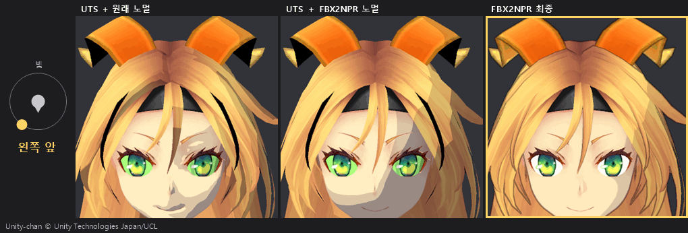

왼쪽부터 UTS + 원래 노멀 / UTS + FBX2NPR 노멀 / FBX2NPR 최종. 빛을 얼굴 둘레로 한 바퀴 돌렸습니다(높이 25°). 유니티짱: © Unity Technologies Japan/UCL

* 시험 캐릭터 16명으로 변환을 확인했고, 결과 그림에는 3명(유니티짱 1, 애니풍 2)을 실었습니다.
* 추가 비용 0.52 ms (빌드, 믹사모 캐릭터 30명, 외곽선 제외)
* 변환 시간 모델당 20초 이내 (시험 캐릭터 16명, 손으로 같은 결과를 만들면 약 1시간)
* Unity 6 URP · C# · HLSL

## 목표

툰용으로 만들지 않은 캐릭터(일반 모델링 캐릭터, VRoid, AI 보조 제작 모델 등)에 툰 셰이더를 입히면 얼굴에 얼룩진 그림자가 생깁니다. 보통은 Blender에서 노멀을 손으로 고치거나, 그림자 텍스처(SDF)를 직접 그려서 해결합니다.

이 프로젝트는 그 첫 단계를 Unity 안에서 자동으로 처리하는 파이프라인을 구축하고, 빛 방향·애니메이션·표정이 바뀌어도 결과가 유지되는지 수치로 검증하는 것을 목표로 했습니다.

## 결합 이론

얼굴 명암을 정리하는 파이프라인을 구축하기 위해, 아래 다섯 가지 이론과 기법을 참고해 결합했습니다.

* **노멀 정리:** X-Toon 노멀 섞기와 구면 선형 보간(slerp)으로 얼굴 노멀을 공 모양에 가깝게 정리합니다. 머리카락은 머리 중심의 캡슐(위는 구, 아래는 원통) 방향과 섞어, 가닥마다 갈리던 명암을 한 덩어리로 만듭니다. 얼굴의 원래 노멀은 UV3·UV4(탄젠트 공간)에 따로 보관해, 명암용과 선용으로 나눠 씁니다.
* **얼굴 명암 규칙:** 램버트 조명과 셀 셰이딩을 바탕으로, 얼굴은 빛의 좌우 성분만 써서 명암선을 긋습니다. 턱 쪽은 얼굴 폭이 타원처럼 좁아진다고 보고 명암선을 모으고, 코 음영은 원래 노멀로 잰 코의 위치와 크기에 맞춰 그립니다.
* **SDF 그림자 맵:** 이 규칙을 빛 각도 5°마다 마스크로 굽고, 거리 변환(Felzenszwalb)으로 한 장의 맵으로 합칩니다. 규칙과 거의 같은 그림을 내면서도 손으로 고칠 수 있습니다.
* **외곽선:** 깊이와 원래 노멀에 소벨 필터를 걸어 그리고, 캐릭터가 멀어지면 얼굴 안쪽 선을 줄입니다.
* **실행 비용:** SRP Batcher가 동작하는 재질 구성, 바뀐 값만 넣는 리그, GPU 스키닝을 따라 도는 원래 노멀로 실행 중 부담을 줄였습니다.

각 이론의 설명과 출처는 아래 [어떻게 동작하나](#어떻게-동작하나)에 있습니다.

## 개선 과정

결과는 숫자 하나가 아니라 최종 그림을 직접 비교하며 골랐습니다.

* 명암선이 코를 지나 한쪽 볼이 그늘에 들어간 뒤에도 코 옆면은 밝게 남겨, 그늘 속에서도 코의 입체감이 드러나게 했습니다. 코는 볼보다 앞으로 나와 있어 빛을 더 오래 받기 때문입니다.
* 명암선 위치는 기준 빛(35°)에서 얼굴 폭의 75%보다 안쪽으로 들어오지 않게 보정했습니다. 75%는 유니티짱 얼굴에 직접 그린 선에서 정했습니다.
* 피부는 밝은데 눈 위로만 그늘 띠가 지나가는 문제가 있어서, 눈 메시는 명암을 받지 않게 했습니다.

무언가 바꿀 때마다 시험 모델 16명을 다시 변환하고, 의도한 곳만 바뀌었는지 화소 단위로 비교했습니다. 문제를 하나씩 고친 기록은 아래 [발생했던 문제와 해결](#발생했던-문제와-해결)에 있습니다.

## 알게 된 점

* **노멀만 고쳐서는 부족합니다.** 공 모양 노멀로 업데이트 할 경우, 얼룩의 수치는 줄어들지만 얼굴이 공처럼 칠해져 어색하게 보이게 됩니다. 그래서 얼굴 전용 명암 규칙이 필요했습니다.
* **지표보다 그림이 먼저입니다.** 얼룩 개수가 줄어도 더 어색해 보일 수 있어서, 최종 그림으로 판단했습니다.
* **재고 나서 고칩니다.**
  * 프로파일러로 느린 원인을 나눈 뒤 고쳐서 리그 0.63 → 0.13 ms, SetPass 182 → 12가 됐습니다.
  * 배터리로 잰 값은 버리고, 전원을 연결한 채 번갈아 다시 쟀습니다.
* **SDF의 가치는 속도보다 편집입니다.** 셰이더 명령어는 789 → 346개, 얼굴 픽셀당 GPU 시간은 약 20% 줄지만, 1080p 화면에서는 0.1 ms 미만 차이입니다.
* **조용한 실패를 조심해야 합니다.**
  * 크기가 4의 배수가 아닌 텍스처는 압축 설정을 켜도 무압축으로 남았습니다.
  * 덮어쓴 메시는 GPU 쪽 데이터가 갱신되지 않았습니다.
  * 그래서 설정만 믿지 않고 결과물을 직접 확인했습니다.

## 한계

* Unity 6 · URP 17에서만 동작을 확인했습니다.
* 얼굴 명암 규칙은 이 프로젝트의 셰이더에서만 동작합니다. 다른 셰이더로는 정리한 노멀과, lilToon 형식으로 바꾼 SDF 맵만 옮길 수 있습니다.
* lilToon 형식으로 내보낼 때 한계가 있습니다.
  * 맵 한 장에 빛 각도 60° 폭만 담습니다(lilToon 기본 경계로 60°\~120°). 그 밖의 빛에서는 명암이 달라집니다.
  * 코 그림자는 큰 명암선에 합쳐집니다.
  * 얼굴 방향은 메시 루트 본의 축을 따릅니다.
  * 같은 재질을 쓰는 몸도 그늘 경계가 또렷해지고 2번째 그림자가 꺼집니다.
* 입력 조건이 있습니다.
  * 머리 뼈 이름에 "head"가 들어가야 합니다.
  * 얼굴 재질 이름에 body·skin·face 중 하나가 들어가야 합니다.
  * 얼굴과 머리카락이 다른 메시여야 합니다.
  * 앞(+Z)을 봐야 하고, 사람 크기여야 합니다.
* 모델에 따라 명암선 위치를 손으로 조정해야 할 수 있습니다.
* 얼굴 UV가 잘게 나뉜 모델은 SDF를 손으로 고치기 어렵습니다.
* 여러 디바이스에 따른 성능 테스트는 진행되지 않았습니다.
* 머리카락은 노멀만 정리했습니다. 림 라이트, 얼굴에 지는 머리카락 그림자, 앞머리 너머로 눈썹·눈을 보이게 하는 스텐실은 다루지 않았습니다.

## 확장

지금은 얼굴 명암 규칙을 실행 중에 셰이더가 계산합니다. 이 규칙을 굽는 단계에서만 쓰고, 정리한 노멀과 SDF 맵을 결과물로 내보내면 다른 셰이더와 렌더 파이프라인에서도 같은 얼굴 명암을 쓸 수 있습니다. 자체 셰이더나 캐릭터마다 붙는 리그가 필요 없어지므로, 셰이더에 묶인 한계와 실행 비용이 함께 줄어듭니다.

남은 한계도 같은 방향으로 풀 수 있습니다.

* **입력 조건:** 얼굴·코·눈 위치를 자동으로 찾되, 사람이 표식으로 바로잡을 수 있게 합니다.
* **아티스트 편집:** 대표 각도 몇 개만 칠하면 나머지 각도를 자동으로 잇게 합니다.
* **잘게 나뉜 UV:** SDF 전용 UV를 만들어 맵을 한 조각으로 펼칩니다.
* **성능:** 모바일을 포함한 여러 기기에서 규칙판과 SDF판의 비용을 비교합니다.

## 제작 동기

툰 셰이더는 밝기를 몇 단계로 끊어 칠합니다. 그래서 얼굴 노멀의 작은 요철이 그림자 경계의 얼룩으로 그대로 드러납니다. 꾸준히 발생되는 문제입니다.

* lilToon README의 "자주 있는 문제"에 "얼굴 그림자가 지저분하다"가 있습니다.
* 같은 문제를 푸는 유료 도구가 팔립니다: lilEasyFace(¥500), Easy Custom Normals($10\~20, 200건 넘게 판매).
* 무료 도구도 있습니다: Blender 애드온 Abnormal, BOOTH의 노멀 전사 도구 18개.
* 3D 아트 커뮤니티 Polycount에서도 2014\~2024년에 여러 번 다뤄졌습니다.

**기존 방식의 한계**

|방식|한계|
|-|-|
|노멀 전사·직접 편집 (Blender)|모델마다 손이 듭니다. 원래 노멀을 덮어써 코·입 선 정보가 사라집니다.|
|그림자 텍스처 (SDF)|캐릭터마다 텍스처를 그려야 하고, 그 텍스처를 읽는 셰이더가 필요합니다.|
|마스크로 가리기|가린 부분의 얼굴 명암을 포기합니다.|

FBX2NPR은 노멀 정리를 Unity로 가져오는 단계에서 자동으로 하고, 원래 노멀은 따로 보관해 코 음영 자리를 재고 선을 그리는 데 씁니다. 빛을 따라 움직이는 얼굴 명암선은 텍스처 대신 셰이더 규칙으로 만들었습니다.
손 작업을 대신하기보다 시작점을 자동으로 만드는 도구입니다. 더 다듬을 곳은 Blender로 보내 손본 뒤 다시 불러올 수 있습니다.

<details>
<summary>출처</summary>

* lilToon README "Common Problems": https://github.com/CuteWaterBeary/shaders.lilxyzw.liltoon (1.3.8 README 사본. 현재 공식 README는 문서 사이트로 연결됨)
* lilEasyFace: https://booth.pm/ja/items/8566350
* Easy Custom Normals: https://superhivemarket.com/products/stylized-normals
* Abnormal: https://github.com/bnpr/Abnormal
* Polycount: https://polycount.com/discussion/121144 (2014), https://polycount.com/discussion/207661 (2019), https://polycount.com/discussion/235329 (2024)
* 참고: GDC 2015 "GuiltyGearXrd's Art Style" https://gdcvault.com/play/1022031 (노멀 편집 세부 내용은 2차 자료로만 확인함)

</details>

## 할 수 있는 것

|기능|설명|
|-|-|
|얼굴 노멀 정리|머리 뼈 가중치로 얼굴 정점을 골라 공 모양으로 정리합니다. 원래 노멀은 따로 보관합니다.|
|머리카락 노멀 정리|머리카락 재질 칸의 노멀을 머리 중심 캡슐 방향과 섞어, 가닥마다 갈리던 명암을 한 덩어리로 만듭니다. 머리카락 외곽선은 메시 노멀 대신 카메라 방향을 쓰므로 이 정리의 영향을 받지 않습니다.|
|얼굴 명암선·코 음영|빛 방향을 따라 움직이고, `ToonFaceRig` 슬라이더로 조절합니다.|
|SDF 그림자 맵|얼굴 명암 규칙을 빛 각도별로 구워 맵 한 장으로 만듭니다. 맵을 손으로 고칠 수 있고, 재질 설정으로 규칙과 맵을 바꿔 씁니다.|
|lilToon 내보내기|`ToonFaceRig` 인스펙터에서 SDF 맵을 lilToon의 SDF 그림자 마스크로 바꾸고, 그 마스크를 넣은 lilToon 재질을 만듭니다. 얼굴 가중치가 없는 곳(같은 텍스처를 쓰는 몸 등)은 lilToon의 보통 그림자로 남깁니다.|
|외곽선|소벨 필터로 그립니다. 보관한 원래 노멀로 코·입 선을 살리고, 캐릭터 셰이더와 상관없이 동작합니다.|
|표정|블렌드셰이프는 얼굴 모양만 바꾸고, 명암은 그대로 둡니다.|
|Blender 왕복|얼굴 노멀을 Blender에서 손보고 다시 불러옵니다. 다시 변환해도 유지됩니다.|
|규격 검사|머리 뼈·얼굴 메시·앞 방향이 안 맞으면 이유를 알려 주고 변환하지 않습니다.|
|웹캠 데모|웹캠 영상으로 방의 빛 방향을 추정해, 명암선이 실제 빛을 따라가게 합니다(브라우저).|

**사용법**

1. Unity 6000.3.9f1(URP 17.3)에서 이 프로젝트를 엽니다.
2. 프로젝트 창에서 캐릭터 FBX를 고르고, 메뉴 `FBX2NPR > 툰 캐릭터로 변환 (선택한 모델)`을 누릅니다.
3. `Assets/FBX2NPRConverted/<모델 이름>/`에 툰 캐릭터 프리팹이 생깁니다.

**대상과 조건**

* 대상: 얼굴 노멀이 툰에 맞게 정돈되지 않은 애니풍 캐릭터(직접 모델링·VRoid·AI 보조 제작)
* 사람형이고, 이름에 "head"가 든 머리 뼈가 있어야 합니다(없으면 Blender에서 붙입니다).
* 얼굴 피부 재질 이름에 body·skin·face 중 하나가 들어가야 합니다(다르면 모델 설정에서 바꿉니다).
* 얼굴과 머리카락이 다른 메시여야 합니다. 한 덩어리 메시(생성기에서 바로 뽑은 모델)는 아직 지원하지 않습니다.
* Unity 기준 앞(+Z)을 봐야 합니다(아니면 Blender에서 돌립니다). 크기는 사람 크기(약 1.5 m)로 맞춰 시험했습니다.

## 어떻게 동작하나

변환은 에디터에서 한 번 하고, 명암과 외곽선은 실행 중에 그립니다. 상자 아래 줄은 그 단계에 쓴 이론입니다.

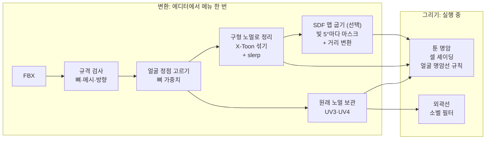

**원래 노멀과 구형 노멀 합치기**

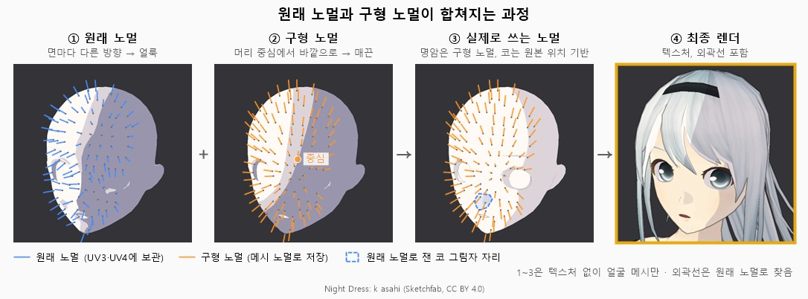

* **① 원래 노멀:** 면마다 방향이 달라서, 툰 명암으로 끊어 칠하면 얼룩이 됩니다.
* **② 구형 노멀:** 머리 중심에서 바깥으로 뻗는 방향입니다. 얼룩 덩어리는 20\~62% 줄지만(5명, UTS·lilToon 등 셰이더 3종), 이것만 쓰면 얼굴이 공처럼 칠해지고 앞쪽 위 빛에서는 턱 아래가 어두워집니다(맨 위 GIF 가운데 칸).
* **③ 실제로 쓰는 노멀:** 메시 노멀은 구형으로 바꾸고 원래 노멀은 UV3·UV4에 남겨, 쓰임새마다 나눠 씁니다.
  * 큰 명암선: 구형 노멀의 좌우 성분만 써서 빛 높이와 상관없이 이마부터 턱까지 한 줄로 긋습니다. 그림자 텍스처(SDF)가 하던 역할을 규칙으로 대신합니다.
  * 코 음영: 변환할 때 원래 노멀로 음영이 질 자리와 크기를 재고(파란 점선), 그 자리에 코 음영을 그립니다. 원래 노멀을 그대로 음영으로 쓰면 애니풍 코에서는 모양 없는 얼룩이 됩니다. 명암선이 코를 지나 그쪽 볼이 그늘이 되면, 같은 자리를 반대로 밝게 칠해 코 옆면이 빛을 받는 모습을 표현합니다.
  * 선: 깊이와 원래 노멀로 찾아 눈·코·입 윤곽을 되살립니다.
* **④ 최종:** 텍스처와 외곽선을 포함한 결과입니다.

**사용한 이론**

|이론|한 줄 설명|이 프로젝트에서|
|-|-|-|
|X-Toon 노멀 섞기 (Barla 외, NPAR 2006)|원래 노멀과 단순한 모양의 노멀을 0\~1 값 하나로 섞습니다.|얼굴 노멀을 공 모양 노멀과 섞어 얼룩을 줄입니다. 머리카락은 캡슐 모양 노멀과 섞습니다. `RadialNormals`, `HairNormals`|
|구면 선형 보간 (slerp)|두 방향을 구 표면을 따라 고르게 잇습니다.|노멀을 섞을 때 씁니다. Lerp는 Blender 결과와 최대 34° 차이, slerp는 평균 0.003° (믹사모 Ch07)|
|램버트 조명 + 셀 셰이딩|밝기 = 노멀과 빛 방향의 내적(N·L). 이를 2\~3단계로 끊어 칠합니다.|얼굴은 N·L의 좌우 성분만 써서 이마부터 턱까지 한 줄 명암선을 만듭니다. `ToonBand.shader`|
|거리 변환 (Felzenszwalb·Huttenlocher, 2012)|흑백 마스크의 각 칸에서 가장 가까운 경계까지의 거리를 선형 시간에 구합니다.|빛 각도 5°마다 구운 명암 마스크를 거리로 바꿔, 칸마다 "몇 도까지 밝은가"를 담은 SDF 맵 한 장으로 합칩니다. `FaceSdfCombine`|
|소벨(Sobel) 필터|주변 3×3 픽셀과 값이 크게 다른 곳을 경계로 찾습니다.|깊이·노멀 이미지에서 외곽선을 찾습니다. 깊이 차를 깊이로 나눠 거리와 상관없이 같은 기준을 씁니다. `SobelOutline.shader`|
|최소제곱법|오차 제곱의 합이 가장 작은 식을 찾습니다.|웹캠의 "피부 밝기 ≈ 상수 + c·노멀"을 풀어 c의 방향을 빛 방향으로 씁니다. `ARFaceDemo`|
|연결 성분 세기|같은 색으로 이어진 덩어리 수를 셉니다.|3단 회색 렌더에서 얼굴의 덩어리 수를 "얼룩 수"로 씁니다.|

코 음영의 모양과 명암선이 눈을 피해 가는 방식은 이론이 아니라 서브컬처 일러스트를 보고 설계했습니다.

## 결과와 사용 예시

**3명을 같은 빛에서 비교** (빛: 수평 35°, 위 25°)

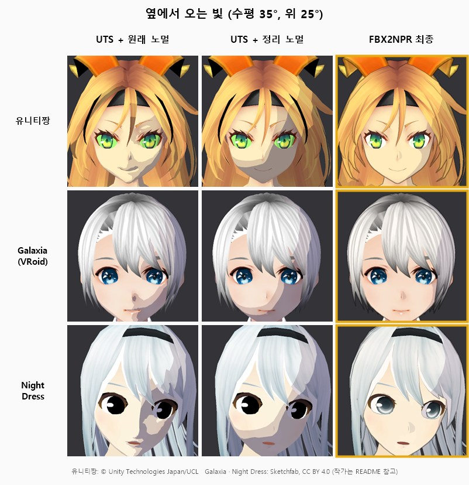

* **UTS + 원래 노멀:** 코·볼·입 옆 그림자가 조각납니다.
* **UTS + 정리 노멀:** 구형 노멀만 넣은 상태라, 얼룩은 줄지만 얼굴이 공처럼 칠해집니다.
* **FBX2NPR 최종:** 큰 명암선, 코 음영, 선을 더한 결과입니다.

모든 모델에 같은 기본 설정을 걸었고, 각 모델의 공식 재질은 아닙니다.

**빛을 한 바퀴 돌렸을 때** (3명, FBX2NPR 최종)

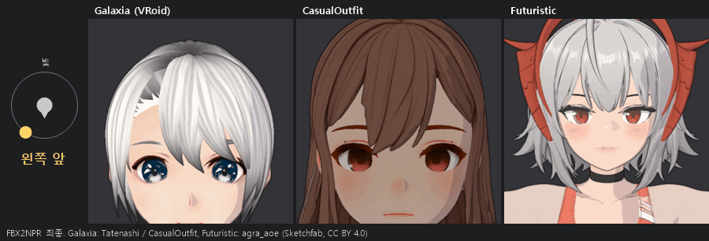

명암선이 빛을 따라 움직입니다. 옆빛에서는 한 줄 명암선, 뒤쪽 빛에서는 얼굴 전체 그늘, 앞빛에서는 밝은 얼굴이 됩니다. 명암선이 코를 지난 뒤에도 코 옆면이 밝게 남아 입체감이 유지됩니다.

**lilToon으로 내보냈을 때** (3명, 빛: 수평 70°, 위 25°)

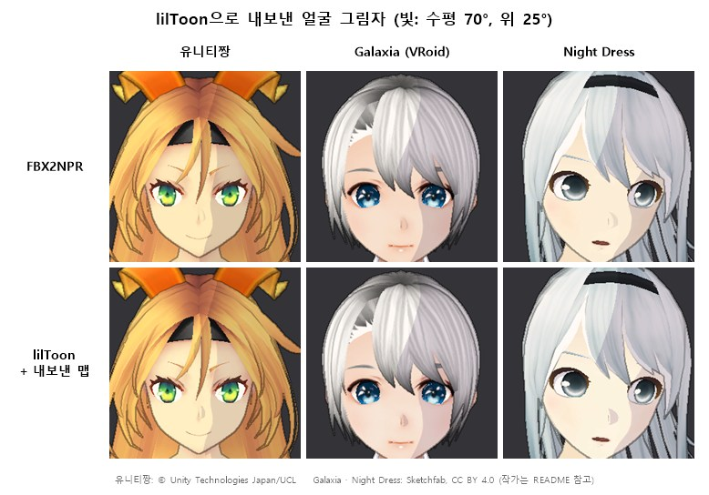

* 위는 FBX2NPR, 아래는 내보낸 맵을 넣은 lilToon입니다. 두 줄 모두 FBX2NPR 외곽선을 켰고, lilToon 그늘은 내보낼 때 넣는 연한 기본값(세기 0.6, 경계의 붉은 띠 끔)입니다.
* 빛이 60°\~120° 안이면 FBX2NPR과 밝음·그늘이 다른 화소가 0.5\~4.0%입니다(3명, 빛 14방향 중 범위 안).
* 범위 밖에서는 lilToon 형식 한 장으로 담을 수 없어 달라집니다. 앞쪽 45°에서는 그늘이 덜 지고, 뒤쪽 135°에서는 얼굴 전체가 그늘이 됩니다(다른 화소 최대 39%).
* lilToon은 메시 루트 본의 축을 얼굴 방향으로 씁니다. Galaxia는 glTF에서 변환하면서 루트 본이 90° 돌아가 있어, 루트 본을 앞을 보는 빈 오브젝트로 바꾼 뒤 찍었습니다. 이런 렌더러는 내보낼 때 알려 줍니다.

**그 밖의 측정**

|항목|결과|
|-|-|
|변환 시간|모델당 0.4\~17초, 16명 중 12명은 2\~5초 (가장 긴 17초는 피부 평탄화를 켠 Ch07). 같은 결과를 손으로 만들면 약 1시간 (직접 작업 기준)|
|Blender 결과와의 노멀 차이|평균 0.003°, 최대 0.79° (믹사모 Ch07)|
|멈춰 있을 때 화면 떨림|0화소 (에디터·빌드)|
|애니메이션 중 얼굴 명암|머리 뼈로 움직인 결과, 머리를 통째로 돌린 결과, 카메라·빛을 반대로 돌린 결과가 같음 (160장 비교, 다른 화소 0.00%)|
|SDF 맵과 규칙의 차이|다른 화소 약 0.1%. 셰이더 명령어 789 → 346개, 1080p에서 0.1 ms 미만 차이|
|SDF 맵 메모리|BC7 압축으로 24.4 → 6.6 MB (맵 5장), 화면 차이 없음|
|웹캠 빛 방향 추정|오차 1.5° 이내, 초당 15회 (합성 데이터)|

## 발생했던 문제와 해결

**1. 표정을 켜면 얼굴이 사라짐**
* 원인: 변환기가 기존 메시 파일에 내용만 덮어써서, 정점 배치가 바뀌자 SkinnedMeshRenderer가 그리기를 멈췄습니다(에디터 로그로 확인).
* 해결: 덮어쓴 메시를 저장하고 다시 불러옵니다. 무표정 화면은 전과 0.35% 다른데, 표정을 켜고 가져오면 Unity가 정점을 다르게 나누기 때문입니다(원본 모델 화면도 0.4% 달라짐).

<details>
<summary>화면 보기</summary>

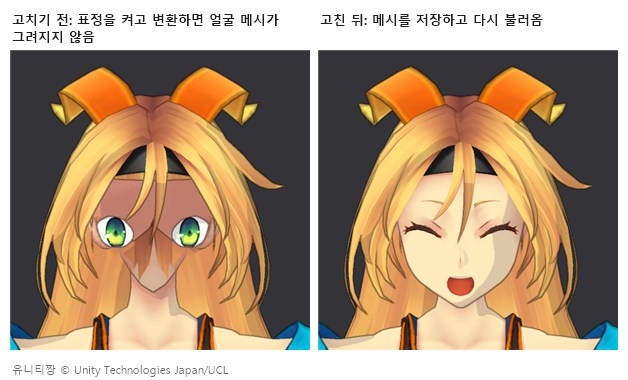

</details>

**2. 입 둘레에 수염 같은 무늬**
* 원인: 입·눈 정점이 머리 뼈 아래의 입·눈 뼈에 묶여 있어 얼굴로 인식되지 않았습니다(얼굴 정점 1957개 중 316개).
* 해결: 머리 아래 뼈 중 이름에 mouth·jaw·lip·eye·brow·cheek가 든 뼈도 얼굴로 봅니다. 머리 아래 뼈를 전부 넣으면 앞머리·장신구 뼈까지 들어와서 이름으로 좁혔습니다. 기존 시험 캐릭터의 결과는 그대로입니다.

**3. 코 음영이 이마에 잡히고, 고치자 코 옆이 얼룩짐**
* 원인: 코끝을 "정중선 근처에서 가장 앞으로 나온 점"으로 찾았는데, 코가 작은 Night Dress는 이마 아래쪽이 코끝보다 4 mm 더 앞이라 눈보다 4.4 cm 위를 코끝으로 잡았습니다. 노멀 시각화 그림을 만들다가 코 영역이 이마에 찍힌 것을 보고 찾았습니다.
* 해결: 눈 메시를 먼저 찾고, 코끝은 눈높이 아래에서만 찾습니다. 코끝이 눈보다 3.1 cm 아래로 내려왔고, 함께 틀렸던 턱 끝도 찾게 됐습니다. 다른 모델은 코끝이 이미 눈 아래라 그대로입니다.
* 다음 원인: 코 음영이 진짜 코에 그려지자, 원래 노멀을 그대로 쓴 음영이 빛이 옆으로 갈수록 코 옆에 모양 없는 얼룩으로 커졌습니다. 같은 방식을 쓰던 다른 애니풍 모델도 같았습니다.
* 해결: 코 음영은 늘 원래 노멀로 잰 자리와 크기에 맞춘 도형으로 그립니다. 전에는 코가 평평한 모델만 이 방식을 썼습니다.

<details>
<summary>화면 보기</summary>

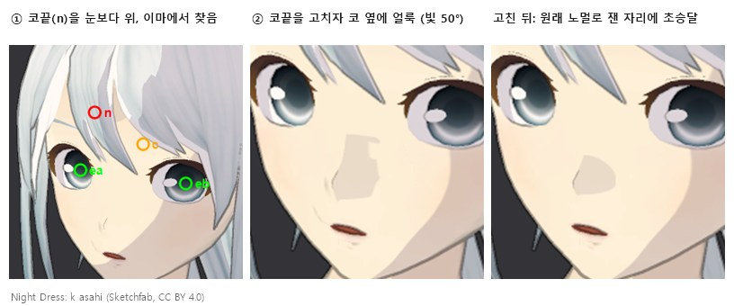

</details>

**4. 툰으로 바꾸면 느려짐** (빌드, 믹사모 Ch07 30명)
* 원인: 얼굴 리그가 매 프레임 모든 값을 다시 넣었고(0.63 ms), 툰 셰이더가 SRP Batcher와 호환되지 않았습니다.
* 해결: 바뀐 값만 넣게 했습니다(리그 0.63 → 약 0.13 ms). 재질 값 목록을 하나로 합치고 프로퍼티 블록 대신 캐릭터별 재질 사본을 써서 SRP Batcher가 동작하게 했습니다(셰이더 상태 전환 명령 SetPass 182 → 12).
* 결과: 원래 재질보다 늘어난 프레임 시간(외곽선 제외) 1.25 → 0.52 ms. 화면은 화소 단위로 같습니다.

<details>
<summary>측정 보기</summary>

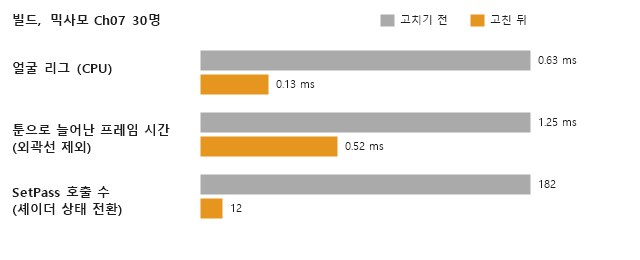

</details>

**5. 애니메이션에서 왼발이 꼬임**
* 원인: 클립마다 아바타를 따로 만들었습니다.
* 해결: T포즈 아바타 하나를 모든 클립이 같이 쓰게(CopyFromOther) 설정했습니다. 왼발 오차 걷기 110.6° → 0.2°, 달리기 173.9° → 16.6°.

<details>
<summary>화면 보기</summary>

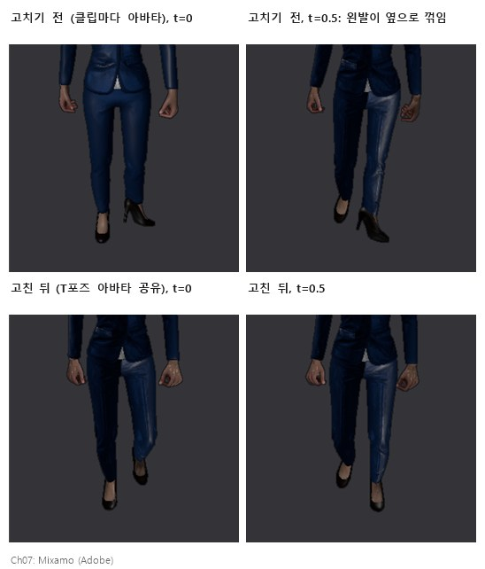

</details>

**6. 비스듬히 보면 얼굴에 팔자주름 같은 선이 생김**
* 원인: 외곽선은 카메라까지의 거리(깊이)가 크게 바뀌는 곳에 선을 긋습니다. 얼굴을 비스듬히(3/4) 보면 코볼·입 옆처럼 옆으로 돌아가는 면은 끊긴 곳이 없어도 거리가 빠르게 바뀝니다. 그래서 해당 부분에 선이 발생했습니다. Night Dress처럼 눈·코·입을 텍스처에 그린 얼굴은 얼굴 테두리만 그려야 하는데, 이 선이 남은 것입니다.
* 첫 시도: 이런 얼굴 안에서는 거리 변화에 덜 민감하게(1/4) 했습니다. 그러자 턱 아래 목까지 얼굴로 잡혀 있던 CasualOutfit에서 턱선까지 흐려졌습니다.
* 해결: 거리가 "고르게 바뀌는 곳"(옆으로 돌아가는 면)과 "툭 끊기는 곳"(턱과 목 사이)을 구분했습니다. 한 화소를 양옆 화소와 비교해서, 고르게 바뀌면 선을 긋지 않고 툭 끊길 때만 그어지도록 하였습니다.
* 결과: Night Dress·유니티짱·CasualOutfit을 정면과 3/4에서 확인했습니다. 턱선은 그대로이고, 코 옆·입꼬리의 흐린 선만 사라졌습니다.

<details>
<summary>화면 보기</summary>

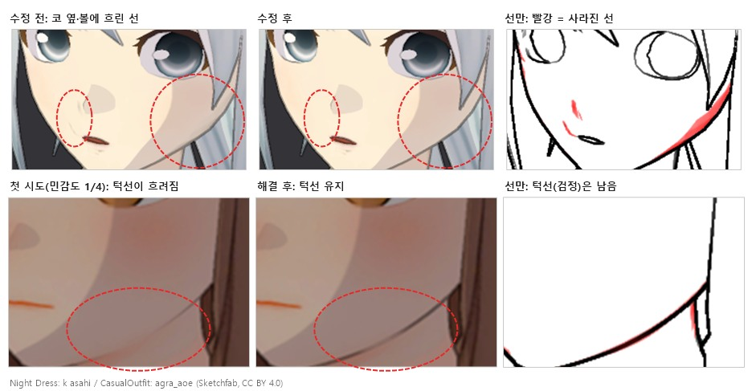

</details>

## 부록

### 사용 에셋

* 믹사모 캐릭터·클립 (성능·정확도 측정과 애니메이션 시험용)
* 유니티짱: © Unity Technologies Japan/UCL, 유니티짱 라이선스 조항(UCL 2.0)을 따릅니다 (https://unity3d.jp/unity-chan/license?lang=en)
* 애니풍 시험 캐릭터 (Sketchfab, 모두 CC BY 4.0, 렌더 이미지만 사용. 이미지별 출처는 [Docs/readme/CREDITS.md](Docs/readme/CREDITS.md))
  * "Galaxia anime girl" by Tatenashi (https://sketchfab.com/Tatenashi)
  * "Night Dress" by k asahi (https://sketchfab.com/asahifac)
  * "Anime Girl Casual Outfit | Stylized 3D Character" by agra_aoe (https://sketchfab.com/AoG.01) — 발생했던 문제 6의 그림에만 사용
* 비교용 셰이더: lilToon, Unity Toon Shader(UTS)

### 폴더 구조

```
Assets/FBX2NPR/
├─ Product/             변환에 쓰이는 코드
│  ├─ Runtime/          리그(ToonFaceRig), 노멀 정리(얼굴·머리카락), 외곽선 피처, 모델 설정
│  ├─ Shaders/          툰·외곽선 셰이더, 얼굴 명암 규칙(ToonFaceRule)·SDF(FaceSDF)
│  ├─ Editor/           변환기, 임포터, SDF 굽기, 인스펙터
│  └─ */Experimental/   실험 기능: 얼굴 파싱, 피부 평탄화, 이목구비 그리기, 회화풍
├─ Measure/             실험·비교·진단, 빌드 검증
│  ├─ Editor/
│  ├─ RuntimeCheck/
│  └─ Shaders/
├─ Tests/Editor/        EditMode 테스트
├─ Capture/Editor/      포트폴리오용 캡처
└─ Models/              얼굴 파싱 ONNX 자리 (저장소에는 없음)
ARFaceDemo/             웹캠 데모 (브라우저)
```
